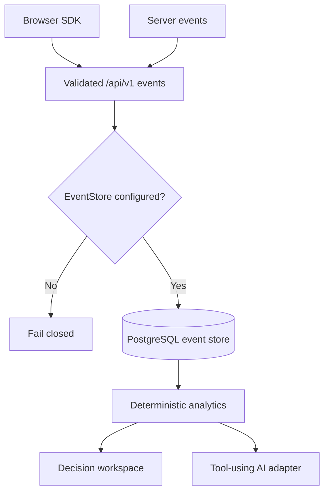

# Architecture

## Current delivery

The web application is a Next.js 16 modular monolith. Server Components own the route shell; the analytics workspace is a client boundary because navigation, the funnel canvas, charts and simulation are interactive. Pure calculation modules live under `src/lib` and are independent of React.

The public Vercel deployment runs in labelled, read-only seed mode. `/api/v1/events` validates authentication and schema but refuses persistence until a real store adapter exists.

## Production completion boundary

Before real data is accepted, implement and verify:

1. Auth.js organization membership and OWNER/ADMIN/ANALYST/VIEWER authorization.
2. Tenant-scoped Drizzle repositories and versioned PostgreSQL migrations.
3. Idempotent event writes, identity linking and aggregation workers.
4. Redis/BullMQ rate limits and jobs.
5. Stripe signature validation and revenue reconciliation.
6. Encryption for provider secrets and hashed API keys.
7. Tenant-isolation integration tests and data deletion/export workflows.

This boundary is deliberate: a dashboard must not imply durable ingestion when durable storage is absent.
