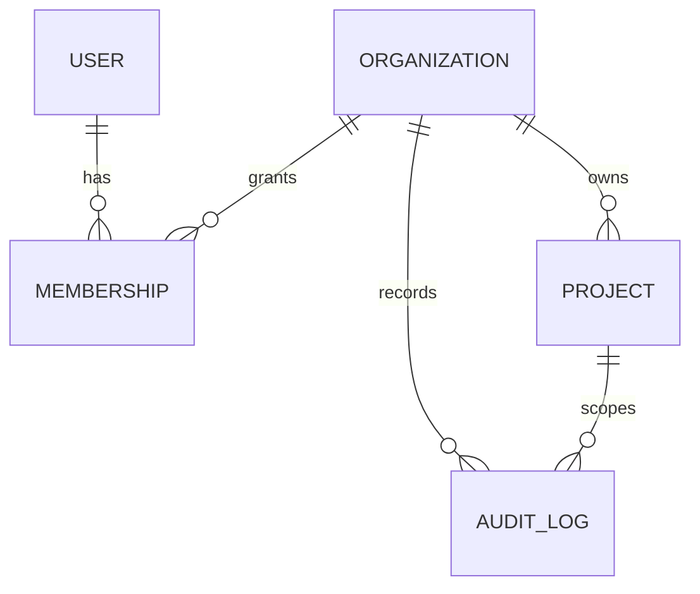

# Database

All external identifiers are UUIDs. Timestamps are stored with timezone in UTC. A project belongs to exactly one organization. Membership is unique per user and organization.

Future events, people, sessions, funnels, orders, integrations and attribution records will carry both project and organization scope.

